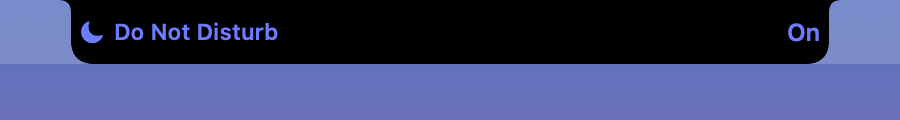
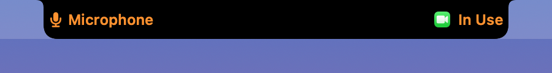
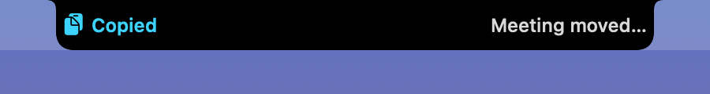
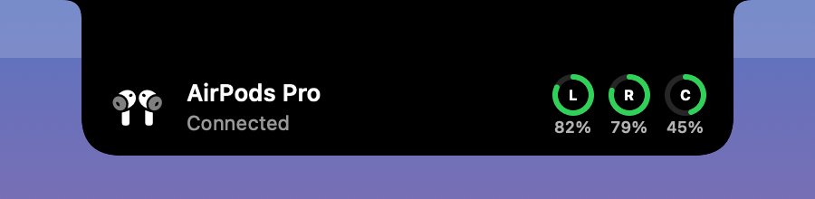
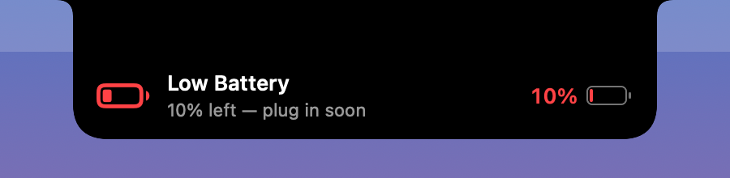
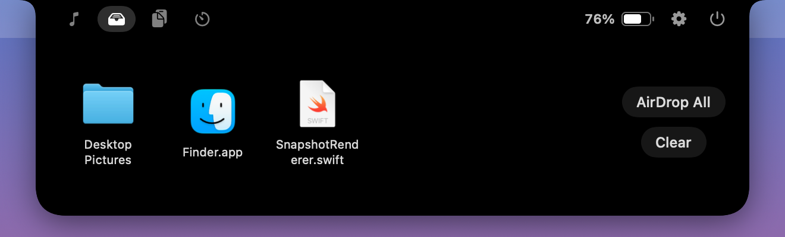
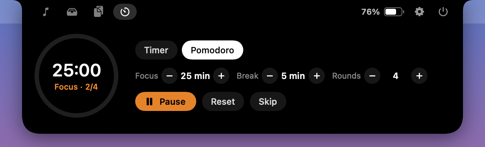
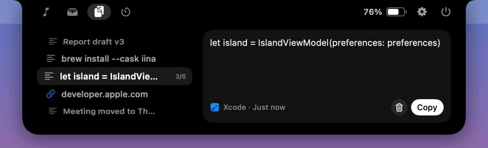
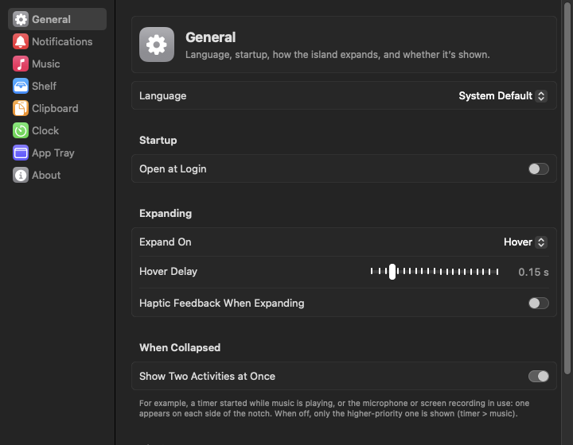
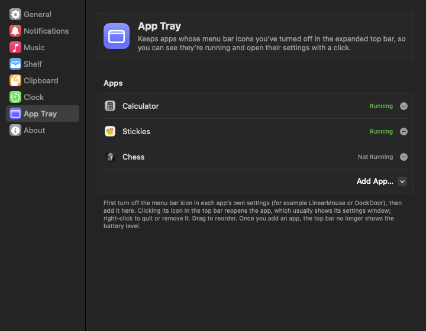

# DynamicIsland

**English** ｜ [繁體中文](README.zh-TW.md)

Turns the MacBook notch into an iPhone-style Dynamic Island. It lives only on the built-in display's notch; external displays are left alone.

<p align="center">
  
</p>

> The interface is available in English and Traditional Chinese.

## Screenshots

### Collapsed

Ongoing activities sit on either side of the notch; when two run at once, each gets one side.

| | |
|---|---|
| <br>Now playing | <br>Music + timer |
| <br>Charging | <br>Volume |
| <br>Focus | <br>Microphone in use |
| <br>Clipboard | |

### Notifications

| | |
|---|---|
| <br>AirPods connected | <br>Timer finished |
| <br>Low battery | |

### Expanded

| | |
|---|---|
| <br>File shelf | <br>Pomodoro |
| <br>Clipboard history | <br>Settings |
| <br>App tray in the top bar (color = running) | <br>App tray settings |

The screenshots are rendered by the app itself with `make screenshots` (fake wallpaper and song), not screen recordings.

## Features

| Feature | Collapsed | Expanded |
|---|---|---|
| Now playing | Artwork on the left of the notch, a waveform on the right; swipe left/right on the island with the trackpad to change tracks | Artwork, title, a draggable progress bar, skip back/forward 15 s, previous/play/next, output device picker; shuffle and repeat when the player supports them; click the artwork to open the playing app |
| Charging & battery | Shows "Charging" and the level when plugged in; alerts once each at low battery (20 %, 10 %) and when fully charged | Battery level in the top bar (when the app tray is empty) |
| App tray | — | Apps whose menu bar icons you've turned off (DockDoor, LinearMouse…) sit on the right of the top bar: in color when running, gray when not. Click one to reopen it (usually shows its settings window); right-click to open settings, launch, quit or remove it |
| File shelf | Drag files onto the notch to expand it | Drop onto the shelf or AirDrop; drag items back out, double-click to open, right-click for a menu |
| Timer / Pomodoro | Progress ring and time remaining | Presets (1/10/30/60/90/120 min), Pomodoro focus/break lengths and rounds, start/pause/reset/skip |
| Bluetooth headphones | Alert on connect/disconnect; AirPods show left, right and case battery | — |
| Volume | Speaker icon and level bar beside the notch when you change volume or mute | — |
| Focus | Icon, name and state when a Focus mode turns on or off | — |
| Microphone / screen recording | Alert when use starts and stops; the microphone alert shows which app is using it | An orange (microphone) or purple (screen recording) indicator in the top bar while in use |
| Clipboard | When you copy or cut, the icon on the left bounces and a preview slides out on the right (start of the text, image thumbnail, or file count) | A wheel like a timer dial on the left showing 5 entries at a time (trackpad scroll, mouse wheel or ↑ ↓, with a light haptic tick per entry; trackpad speed is adjustable in Settings), and a preview of the selected entry on the right; Return copies, Esc collapses; click the middle entry or the preview to copy it again, right-click to remove or clear. Keeps up to 30 entries |

- Now playing is system-wide: any app works, including YouTube in a browser (via [mediaremote-adapter](https://github.com/ungive/mediaremote-adapter)). If a future macOS blocks this, the app falls back to a mode that only supports Music and Spotify.
- When two activities run at once (music + timer, music + microphone, timer + screen recording…), the collapsed island shows one on each side of the notch, with music always on the left. Microphone / screen recording only appear next to another activity and never take over the island on their own. You can turn this off in Settings › General › When Collapsed to show only the highest-priority activity (timer > music).
- Every kind of alert (including volume, Focus, microphone and screen recording) and the clipboard history can be turned on or off individually in Settings.
- Clipboard history is kept in memory only and cleared when the app quits; content that password managers mark as concealed (`org.nspasteboard.ConcealedType` and similar) is never recorded.
- The interface follows your macOS language order: Traditional Chinese if Chinese comes before English, English otherwise. To choose one yourself, use Settings › General › Language (takes effect after a restart).
- Hovering over the notch expands the island (or switch to click-to-expand), and moving away collapses it; clicks outside the island pass straight through to the menu bar.

## Requirements

- A MacBook with a notch, running macOS 14 or later (developed on a MacBook Air M5 with macOS 27)
- Xcode or the Command Line Tools (Swift 6.2 or later). The Command Line Tools alone are enough to build.

## Build and run

```bash
make run
```

This compiles, assembles `build/DynamicIsland.app` and launches it. Other commands:

| Command | Description |
|---|---|
| `make debug` | Debug build; adds a "Simulate Event" submenu to the menu bar item so you can preview plugging in, AirPods, timer finished and more without real hardware |
| `make install` | Installs to `~/Applications` and launches it (recommended if you use "Open at login") |
| `make test` | Runs the unit tests (Swift Testing) |
| `make screenshots` | Regenerates the README screenshots in both languages (`docs/images/en`, `docs/images/zh-Hant`) |
| `make icon` | Regenerates `Resources/AppIcon.icns` |
| `make clean` | Deletes build products |

The app has no Dock icon; use the capsule icon in the menu bar to open Settings, temporarily hide the island, or quit.

## Permissions on first launch

| Permission | When it's requested | Used for |
|---|---|---|
| Bluetooth | At launch | Detecting headphones connecting/disconnecting |
| Automation (Music, Spotify) | Only in fallback mode | Reading artwork and controlling playback |
| Files and Folders | When the shelf holds files from Desktop, Documents or Downloads | Checking the files still exist and generating thumbnails |
| Full Disk Access | Never requested automatically; add it in System Settings › Privacy & Security (the Settings window has a button for this) | Reading the Focus state; without it everything else works, just without Focus alerts |

### Stop permissions from being requested after every rebuild

Builds are ad-hoc signed by default, so the signature changes on every rebuild and macOS asks for Bluetooth access again. To avoid that, create a self-signed certificate:

1. Open Keychain Access → menu Keychain Access › Certificate Assistant › Create a Certificate…
2. Name it `DynamicIsland Dev`, set Identity Type to "Self Signed Root" and Certificate Type to "Code Signing", then click Create
3. Build like this from then on:

```bash
SIGN_IDENTITY="DynamicIsland Dev" make run
```

## Project structure

```
Package.swift                 Swift Package (no Xcode project needed)
Makefile, scripts/            Build, bundling, signing, app icon, README screenshots
Resources/                    Info.plist, app icon, localized app name and permission prompts (*.lproj)
Vendor/mediaremote-adapter/   System-wide now playing (BSD-3, see Vendor/README.md)
docs/images/                  README screenshots (en, zh-Hant)
Sources/DynamicIsland/        Entry point
Sources/DynamicIslandKit/
  App/        Startup, service wiring, menu bar item
  Window/     Notch panel, notch geometry, mouse tracking
  Island/     State machine (priorities, event queue), shape, collapsed/notification/expanded views
  Features/   NowPlaying, Battery, Timer, Shelf, Bluetooth, Clipboard, Focus, Sensors (microphone/screen recording), System (volume)
  Settings/   Preferences, Settings window, open at login
  Support/    Shared helpers
Tests/DynamicIslandKitTests/  Unit tests
```

## Development notes

- **Command Line Tools only**: in this SDK `@State` is a macro whose implementation ships only with Xcode, so the code uses `@ViewState` (an alias for the `State` property wrapper). `#Preview`, Asset Catalogs and String Catalogs are unavailable too.
- **Swift Testing**: with only the Command Line Tools, SwiftPM's default build system doesn't load the Testing macro plugin. `make test` adds it for you; plain `swift test` fails to compile.
- **Snapshots**: after `make debug`, run `.build/debug/DynamicIsland --snapshots <folder>` to render every state as a PNG (the red box marks the physical notch; add `--no-guides` to hide it). No screen recording permission needed. `--settings-snapshots <folder>` renders each Settings page.
- **Localization**: UI strings are written in both languages side by side, e.g. `tr("充電中", "Charging")` (see `Support/Localization.swift`); the language is decided once at launch. Add `-AppleLanguages "(en)"` to the snapshot commands above to render a specific language.
- **Logs**: `log stream --predicate 'subsystem == "com.howardyu.DynamicIsland"' --info`

## Known limitations

- System-wide now playing relies on mediaremote-adapter using the system `/usr/bin/perl` to read a private framework, which a future macOS update may break (the app then falls back to Music/Spotify mode).
- The collapsed music capsule covers menu bar items next to the notch; you can turn off "Show Artwork and Waveform Beside the Notch" in Settings › Music.
- The waveform animation is decorative, not a real spectrum.
- Focus has no public API, so the app reads the database in `~/Library/DoNotDisturb/DB`, which requires Full Disk Access. Only Focus modes turned on manually (Control Center, Shortcuts) are recognized; scheduled ones don't trigger an alert. With ad-hoc signing you also need to re-allow access after each rebuild (see the self-signed certificate above).
- Screen recording detection uses the private WindowServer function `SLSIsScreenWatcherPresent`, so screen sharing and AirPlay mirroring may count too. If a future macOS removes the function, the toggle in Settings is greyed out.
- On macOS 14.2 and later, microphone detection can tell which app is using it (Core Audio's process list); older systems only know that something is.
- The clipboard is checked every 0.5 s via `changeCount` (macOS has no clipboard change notification). Items over 20 MB aren't recorded, and once the history exceeds 64 MB the oldest entries are dropped.
- The system clipboard doesn't record whether content was copied or cut, so both show the same animation; telling them apart would require monitoring the keyboard (Accessibility permission), which the app doesn't do.
- AirPods battery levels are read from `system_profiler`; right after connecting they're sometimes unavailable, in which case only the name is shown.

## License

Released under the MIT License; see [LICENSE](LICENSE).

`Vendor/mediaremote-adapter` is licensed under BSD-3-Clause, © Jonas van den Berg and contributors.
