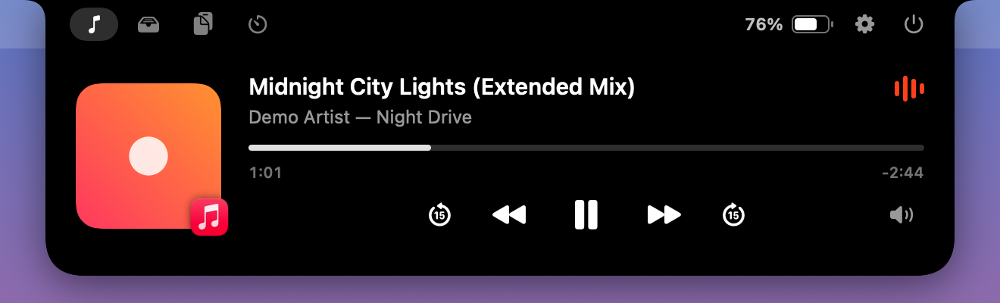
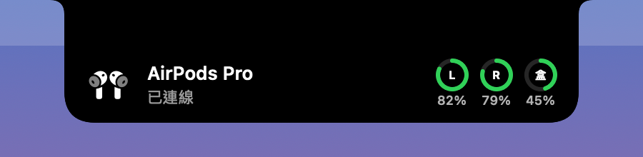
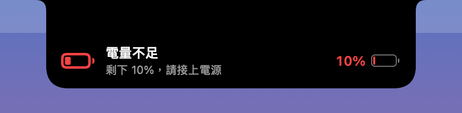
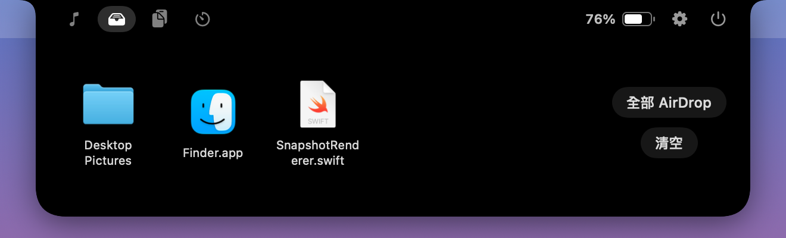
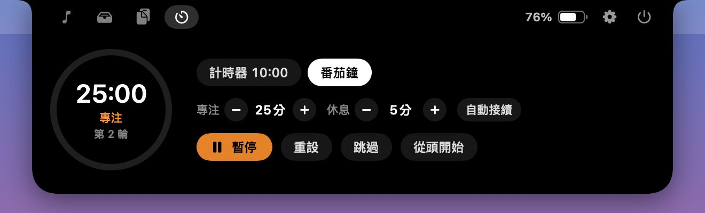
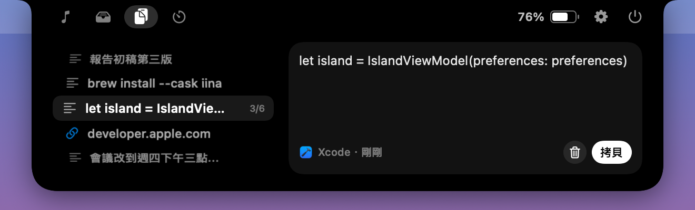
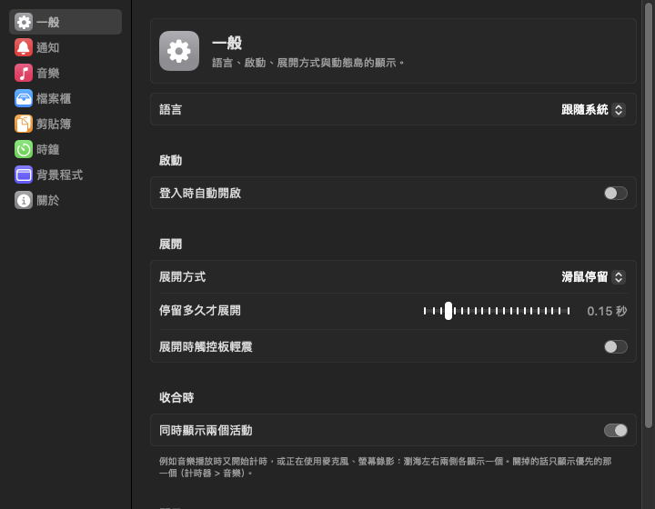
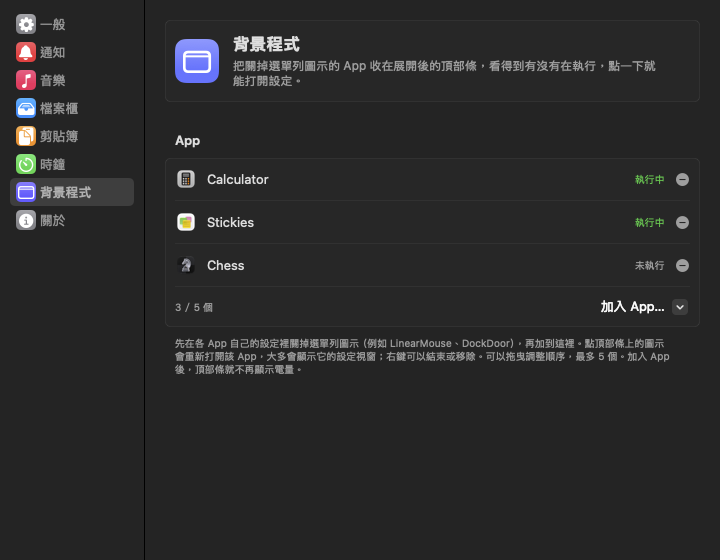

# Islet

[English](README.md) ｜ **繁體中文**

把 MacBook 的瀏海變成 iPhone 那樣的動態島。只顯示在內建螢幕的瀏海上，外接螢幕不受影響。

<p align="center">
  
</p>

## 截圖

### 收合時

瀏海兩側顯示正在進行的活動；兩個活動同時進行時左右各放一個。

| | |
|---|---|
| <br>音樂播放 | <br>音樂＋計時器 |
| <br>充電中 | <br>音量 |
| <br>專注模式 | <br>麥克風使用中 |
| <br>剪貼簿 | |

### 提示

| | |
|---|---|
| <br>AirPods 連線 | <br>計時結束 |
| <br>低電量 | |

### 展開後

| | |
|---|---|
| <br>檔案暫存架 | <br>番茄鐘 |
| <br>剪貼簿紀錄 | <br>設定 |
| <br>頂部條的背景程式（彩色的是執行中） | <br>背景程式設定 |

截圖是用 `make screenshots` 從程式產生的（假的桌布與歌曲），不是螢幕錄影。

## 功能

| 功能 | 收合時 | 展開後 |
|---|---|---|
| 音樂播放 | 瀏海左邊是封面、右邊是音波；觸控板在島上左右滑可以切歌 | 封面、歌名、可拖曳的進度條、倒轉／快轉 15 秒、上一首／播放／下一首、切換輸出裝置；播放器支援時多出隨機與重複；點封面打開播放的 App |
| 充電與電量 | 插電時顯示「充電中」與電量；低電量（20%、10%）與充飽電各提示一次 | 沒有加背景程式時，頂部條顯示電量 |
| 背景程式 | — | 把選單列圖示關掉的 App（DockDoor、LinearMouse…）收在頂部條右側：彩色的是執行中、灰色的是沒在執行；點一下重新打開它（大多會顯示設定視窗），右鍵可以打開設定、啟動、結束或移除 |
| 檔案暫存架 | 把檔案拖到瀏海就會展開 | 放到暫存架或 AirDrop；項目可拖出、雙擊開啟、右鍵選單 |
| 計時器／番茄鐘 | 顯示進度環與剩餘時間 | 預設時間（1／10／30／60／90／120 分）、番茄鐘的專注／休息時間與輪數、開始／暫停／重設／跳過 |
| 藍牙耳機 | 連線／中斷時跳出提示，AirPods 顯示左右耳與充電盒電量 | — |
| 音量 | 調整音量或靜音時，瀏海兩側顯示喇叭圖示與音量條 | — |
| 專注模式 | 開啟／關閉時顯示專注模式的圖示、名稱與狀態 | — |
| 麥克風／螢幕錄影 | 開始與停止使用時各提示一次，麥克風會顯示正在使用的 App | 使用中時頂部條多一個橘色（麥克風）或紫色（螢幕錄影）圖示 |
| 剪貼簿 | 拷貝或剪下時左邊的圖示彈一下，右邊滑出內容預覽（文字開頭、圖片縮圖、檔案數量） | 左邊是像計時器轉盤的滾輪，一次看得到 5 筆（觸控板上下滑動、滑鼠滾輪或 ↑ ↓ 鍵，每跳一筆輕震一下；觸控板速度可以在設定調整），右邊預覽選到的那筆；Return 複製、Esc 收合；點中間那筆或預覽就再複製一次，右鍵可移除或清空。最多保留 30 筆 |

- 音樂是「全系統」的：任何 App 都支援，包含瀏覽器裡的 YouTube（透過 [mediaremote-adapter](https://github.com/ungive/mediaremote-adapter)）。如果未來 macOS 擋掉這個做法，會自動改用只支援 Music 與 Spotify 的模式。
- 兩個活動同時進行時（音樂＋計時器、音樂＋麥克風、計時器＋螢幕錄影…），收合時瀏海左右兩側各顯示一個；音樂固定在左邊。麥克風／螢幕錄影只會排在別的活動旁邊，不會單獨佔用島。可以在設定「一般 › 收合時」關掉，改回只顯示優先的那一個（計時器 > 音樂）。
- 每一種提示（含音量、專注模式、麥克風、螢幕錄影）和剪貼簿紀錄都可以在設定裡個別開關。
- 剪貼簿紀錄存在 `~/Library/Application Support/Islet/Clipboard`，結束 App、更新、重新開機後都還在（要刪掉就按「清除紀錄」）；密碼管理器標示為隱藏的內容（`org.nspasteboard.ConcealedType` 等）不會記錄。
- 介面有繁體中文與英文，預設跟著 macOS 的語言順序：中文排在英文前面就用繁體中文，否則用英文。也可以在設定「一般 › 語言」自己指定（重新啟動後生效）。
- 滑鼠停在瀏海上會展開（可改成點擊展開），移開就收合；島以外的區域點擊會直接穿透到選單列。

## 需求

- 有瀏海的 MacBook，macOS 14 以上（在 macOS 27 的 MacBook Air M5 上開發）
- 要自己建置的話：Xcode 或 Command Line Tools（Swift 6.2 以上）。只裝 Command Line Tools 就夠了。

## 下載

到 [Releases](https://github.com/howardyu60211/Islet/releases/latest) 下載 `Islet-<版本>.dmg`，打開後把 Islet 拖進「應用程式」。

App 沒有經過 Apple 公證，第一次打開會被 macOS 擋下。用下面任一種方式允許：

- 先試著打開一次，再到「系統設定 › 隱私權與安全性」，捲到最下面按「強制打開」。
- 或在終端機執行 `xattr -dr com.apple.quarantine /Applications/Islet.app`。

發佈版是 ad-hoc 簽章，所以每次更新後 macOS 會再問一次藍牙權限，「完整磁碟取用權限」也要重新允許。

## 建置與執行

```bash
make run
```

會編譯、組出 `build/Islet.app` 並啟動。其他指令：

| 指令 | 說明 |
|---|---|
| `make debug` | Debug 建置；選單列多一個「模擬事件」子選單，不用實機就能看插電、AirPods、計時結束等畫面 |
| `make install` | 安裝到 `~/Applications` 並啟動（要「登入時自動開啟」建議用安裝後的版本） |
| `make dmg` | Release 建置並打包成 `build/Islet-<版本>.dmg`（版本取自 `Info.plist`），發佈用 |
| `make test` | 執行單元測試（Swift Testing） |
| `make screenshots` | 重新產生 README 的中英文截圖（`docs/images/en`、`docs/images/zh-Hant`） |
| `make icon` | 重新產生 `Resources/AppIcon.icns` |
| `make clean` | 刪掉建置產物 |

App 沒有 Dock 圖示；從選單列的膠囊圖示可以打開設定、暫時隱藏小島或結束。膠囊圖示也可以從它自己的選單或設定「一般 › 顯示」關掉，之後點展開後頂部條的齒輪，或從 Finder、Spotlight 再打開一次 Islet，就會顯示設定。

## 第一次執行時的權限

| 權限 | 什麼時候會問 | 用途 |
|---|---|---|
| 藍牙 | 啟動時 | 偵測耳機連線／中斷 |
| 自動化（Music、Spotify） | 只有退回模式才會問 | 讀封面與控制播放 |
| 檔案與資料夾 | 暫存架裡有「桌面」「文件」「下載」的檔案時 | 檢查檔案是否還在、產生縮圖 |
| 完整磁碟取用權限 | 不會自動問，要到「系統設定 › 隱私權與安全性」手動加入（設定視窗有按鈕） | 讀取專注模式狀態；沒給的話其他功能照常，只是沒有專注模式提示 |

### 讓權限不會每次重建都重問

預設用 ad-hoc 簽章，每次重新建置簽章都會變，macOS 就會再問一次藍牙權限。可以建立一個自簽憑證：

1. 打開「鑰匙圈存取」→ 選單「鑰匙圈存取 › 憑證輔助程式 › 製作憑證…」
2. 名稱填 `Islet Dev`，身分類型選「自簽根憑證」，憑證類型選「程式碼簽署」，按「製作」
3. 之後這樣建置：

```bash
SIGN_IDENTITY="Islet Dev" make run
```

## 專案結構

```
Package.swift                 Swift Package（不需要 Xcode 專案）
Makefile, scripts/            建置、打包、簽章、DMG、App 圖示、README 截圖
Resources/                    Info.plist、App 圖示、各語言的 App 名稱與權限說明（*.lproj）
Vendor/mediaremote-adapter/   全系統「正在播放」（BSD-3，見 Vendor/README.md）
docs/images/                  README 截圖（en、zh-Hant）
Sources/Islet/                進入點
Sources/IsletKit/
  App/        啟動、服務組裝、選單列
  Window/     瀏海面板、瀏海位置計算、滑鼠追蹤
  Island/     狀態機（優先序、事件排隊）、形狀、收合／通知／展開畫面
  Features/   NowPlaying、Battery、Timer、Shelf、Bluetooth、Clipboard、Focus、Sensors（麥克風／螢幕錄影）、System（音量）
  Settings/   設定值、設定視窗、登入時開啟
  Support/    共用小工具
Tests/IsletKitTests/          單元測試
```

## 開發筆記

- **只有 Command Line Tools 時的限制**：這版 SDK 的 `@State` 是 macro，它的實作只跟著 Xcode 發佈，所以程式碼用 `@ViewState`（`State` property wrapper 的別名）。`#Preview`、Asset Catalog、String Catalog 也不能用。
- **Swift Testing**：SwiftPM 的預設建置系統在只有 Command Line Tools 時不會載入 Testing 的 macro plugin，`make test` 會自動補上；直接用 `swift test` 會編譯失敗。
- **外觀快照**：`make debug` 之後執行 `.build/debug/Islet --snapshots <資料夾>`，會把每一種狀態畫成 PNG（紅框是實體瀏海的位置，加 `--no-guides` 就不畫），不需要螢幕錄製權限。`--settings-snapshots <資料夾>` 則是設定視窗的每一頁。
- **在地化**：介面字串把兩種語言寫在一起，例如 `tr("充電中", "Charging")`（見 `Support/Localization.swift`），語言在啟動時決定一次。上面的快照指令加上 `-AppleLanguages "(en)"` 就能畫指定的語言。
- **紀錄**：`log stream --predicate 'subsystem == "com.howardyu.Islet"' --info`

## 已知限制

- 全系統音樂靠 mediaremote-adapter 借用系統的 `/usr/bin/perl` 讀取私有框架，未來 macOS 更新可能失效（會自動退回 Music／Spotify 模式）。
- 收合時的音樂膠囊會蓋住瀏海旁邊的選單列項目；可以在設定裡關掉「收合時在瀏海兩側顯示封面與音波」。
- 音波動畫是裝飾性的，不是真的頻譜。
- 專注模式沒有公開 API，是讀 `~/Library/DoNotDisturb/DB` 裡的資料庫，所以需要完整磁碟取用權限；目前只認得手動（控制中心、捷徑）開啟的專注模式，依時間表自動開啟的不會提示。ad-hoc 簽章每次重建後也要重新允許（見上面的自簽憑證）。
- 螢幕錄影偵測用 WindowServer 的私有函式 `SLSIsScreenWatcherPresent`，螢幕共享、AirPlay 鏡像也可能算在內；未來 macOS 拿掉這個函式時，設定裡的開關會變灰。
- 麥克風偵測在 macOS 14.2 以上能認出是哪個 App（Core Audio 的行程清單）；更舊的系統只知道「有人在用」。
- 剪貼簿是每 0.5 秒檢查一次 `changeCount`（macOS 沒有剪貼簿變更通知）；超過 20 MB 的內容不記錄，整個紀錄超過 64 MB 時從最舊的開始丟。
- 系統的剪貼簿不會記錄內容是「拷貝」還是「剪下」來的，所以兩者顯示一樣的動畫；要分辨只能監聽鍵盤（需要輔助使用權限），目前沒有這麼做。
- AirPods 電量是從 `system_profiler` 讀的，有時候剛連上會讀不到，就只顯示名稱。

## 授權

本專案以 MIT 授權釋出，見 [LICENSE](LICENSE)。

`Vendor/mediaremote-adapter` 為 BSD-3-Clause 授權，© Jonas van den Berg 與貢獻者。
